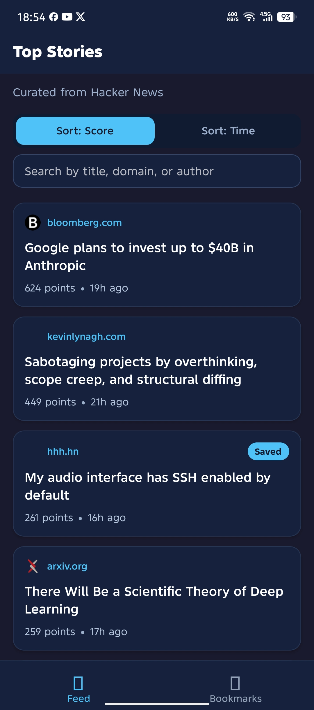
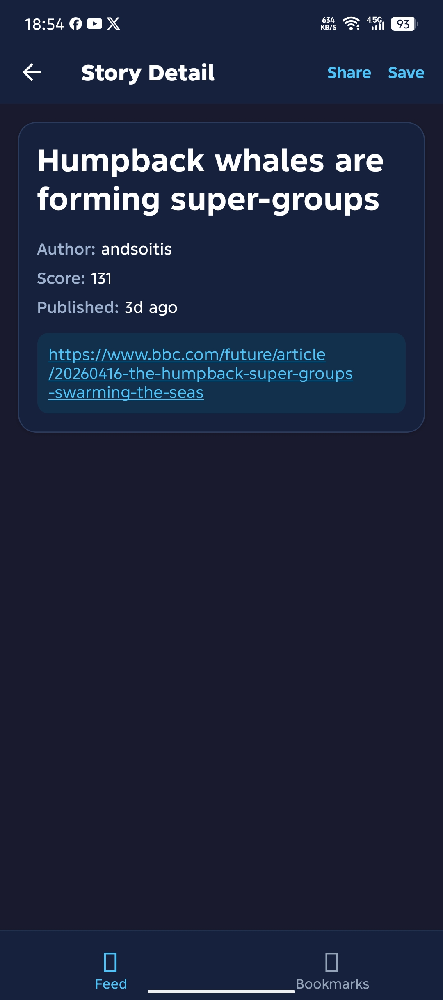
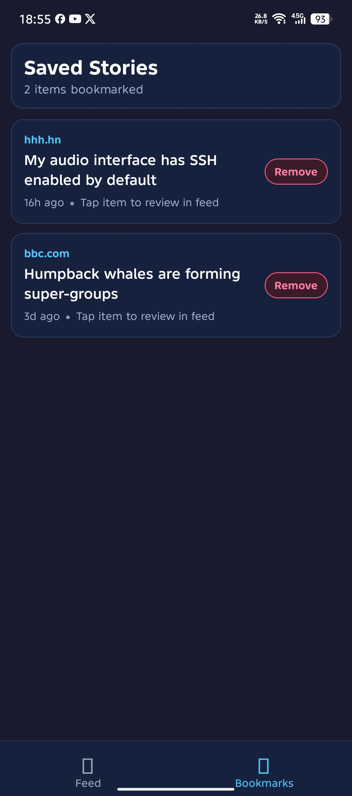
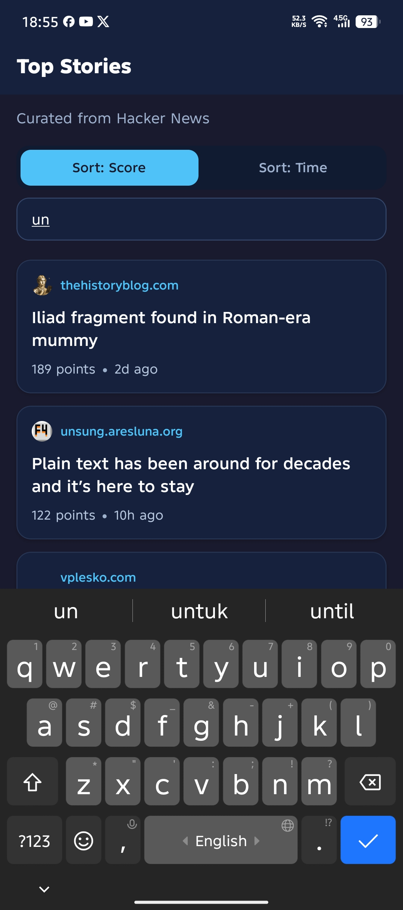

# News Feed App Assessment

React Native CLI + TypeScript implementation for the AutomatedPros technical assessment.

## Setup

Environment used:
- Node: `22.13.1`
- npm: `10.9.2`
- OS for development/testing: Windows 10 (Android validated on real device)

1. Install dependencies:
   - `npm install`
2. iOS only:
   - `cd ios && pod install && cd ..`
3. Start Metro:
   - `npm run start`
4. Run app:
   - Android: `npm run android`
   - iOS: `npm run ios` (run on macOS with Xcode)

## Architecture Decisions

- **React Navigation (Bottom Tabs + Native Stack):** Feed uses stack navigation (`ArticleList`, `ArticleDetail`) and Bookmarks is exposed as a separate tab.
- **State management (Redux Toolkit):** chosen for explicit state transitions, predictable async flow (`createAsyncThunk`), and scalable structure for larger app scope.
- **Feature-based folder structure:** separates app shell, article feature, bookmark feature, and shared utilities to keep each layer focused.
- **Persistence (AsyncStorage):** used for bookmark snapshot (`ids + entities`) so bookmarked stories remain usable across cold restarts.
- **Data shaping at service/util layer:** Hacker News response is mapped to strict app model (`Article`) before reaching UI to avoid logic leakage in components.

## Implemented Requirements (Section 01)

- Fetches top story IDs then requests first 20 item details in parallel (`Promise.all`).
- Filters valid stories (`type === "story"` and `url` exists).
- Article list shows title, source domain, score, relative time, and favicon.
- Pull-to-refresh with `RefreshControl`.
- Handles loading, error, and empty states.
- Sort toggle (score/time), kept in Redux state so selection survives back navigation.
- Detail screen shows title, author, score, relative time, and URL.
- URL opens via `Linking.openURL`.
- Header actions include `Share` and bookmark toggle.
- Bookmark state is persisted with AsyncStorage and restored on cold start.
- List scroll position is restored when returning from detail screen.
- FlatList uses `keyExtractor`, `getItemLayout`, memoized row item.

## Bonus Features (Section 01)

- **Bookmarks tab:** bottom tab navigation includes a dedicated bookmarks screen.
- **Swipe-to-remove:** bookmarked items can be removed using right-swipe action (and remove button fallback).
- **Debounced search:** list screen has client-side debounced filtering (300ms) with no extra API requests.
- **Offline banner:** app shows a top banner when network connectivity is lost (`@react-native-community/netinfo`).

## Submission Checklist (PDF Mapping)

- App runs on Android and iOS targets (Android validated on real device; iOS project/config included).
- TypeScript used throughout with strict app models and no unexplained `any`.
- API integration uses provided Hacker News endpoints (`topstories` + `item/{id}`).
- Pull-to-refresh and loading/error/empty states are implemented and tested manually.
- Bookmark persistence survives cold restart via AsyncStorage snapshot (`ids + entities`).
- List scroll position restores when navigating back from detail screen.
- README includes setup, architecture decisions, trade-offs, and Section 02 answers.
- Tests included: one business-logic unit test and one component interaction test.
- Bonus implemented: Bookmarks tab, debounced search, and offline banner.

## Screenshots

### Feed List

### Story Detail

### Bookmarks Tab

### Search Results

## Testing

- Unit test (business logic): `sortArticles` sorting behavior.
- Component interaction test: sort toggle callback behavior.
- Run tests with: `npm test`

## Known Trade-offs

- Relative time formatter is lightweight and intentionally simple (no locale/pluralization library).
- Scroll restoration uses in-memory offset tracking in list screen, which is sufficient for this two-screen flow.
- API error handling is generic and user-facing copy is concise; granular error categorization can be added later.
- Bookmarks persist full article snapshots to keep the Bookmarks tab useful even if current feed payload changes.

## Section 02 Answers

### Q1 - Bridge vs JSI & The New Architecture

The legacy Bridge sends serialized JSON messages between JavaScript and native modules asynchronously, which introduces overhead and queue contention under heavy traffic. JSI removes that serialization boundary by exposing native functionality directly to the JavaScript runtime through C++ bindings. This addresses a concrete performance issue where high-frequency calls (for example animations, gesture events, or large payload transfers) become bottlenecked by bridge marshalling. With the new architecture, Fabric replaces the old UI manager and enables a more synchronous, prioritized rendering pipeline, while TurboModules provide lazy-loaded and more direct native module access. Together, Fabric and TurboModules reduce communication overhead and improve responsiveness, especially on lower-end devices.

### Q2 - Diagnosing a Janky FlatList

I would start by profiling first, not guessing: use React Native Performance Monitor, Android Studio profiler, and React DevTools Flamegraph to identify whether drops come from JS thread, UI thread, or over-rendering. Next, I would log render frequency and check if list items rerender on unrelated state changes. Then I would apply list-level fixes such as stable `keyExtractor`, tuned `initialNumToRender`, `windowSize`, and `getItemLayout` when row height is predictable. After that, I would optimize row components using `React.memo`, move inline closures/objects to `useCallback` or constants, and avoid expensive calculations inside render. If the problem persists with very large lists, I would evaluate virtualization alternatives such as FlashList and compare frame metrics before and after changes.

### Q3 - useCallback and useMemo

A practical case where `useCallback` helps is passing row press handlers to many memoized list items; stable references avoid invalidating `React.memo` and reduce rerenders. `useMemo` helps when computing derived collections (for example sorted or filtered arrays) from large datasets, so the work only runs when dependencies change. A case where `useMemo` hurts is wrapping cheap calculations or primitive values where memo bookkeeping costs more than recalculation. It can also hurt readability and create stale dependency bugs if used defensively without measurement. I treat both hooks as targeted optimization tools, validated by profiler evidence.

### Q4 - State Management Decision

For a 12-screen app with shared domains like auth, theme, and cart, I would choose Redux Toolkit first. It gives predictable state flow, clear async patterns, good tooling, and scalable conventions for team collaboration. Context API works for low-frequency, narrow-scope global state, but it tends to trigger broader rerenders and becomes harder to structure as complexity grows. Zustand is lightweight and productive, but in larger teams I still prefer Redux Toolkit when strict patterns, traceability, and middleware ecosystem matter. I would change this decision if the app is smaller, domain complexity drops, or the team prioritizes minimal boilerplate over centralized conventions.

### Q5 - Offline-First UX Strategy

I start with connectivity detection using NetInfo and distinguish between "offline" and "online but request failed" states. For caching, I persist the latest successful payload and timestamp locally (AsyncStorage or database depending on data size), and render cached data immediately when network is unavailable. Cache invalidation uses TTL plus explicit refresh triggers, with stale-while-revalidate behavior where possible. For larger datasets or relational data, I would move to SQLite/WatermelonDB or TanStack Query persistence to get better query-level control. Trade-offs include increased complexity in merge/conflict logic and the need for clear UX messaging about stale data.
